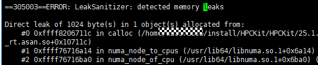

# KuDNN开发指南<a name="ZH-CN_TOPIC_0000002453829069"></a>

-   **[总述](#ZH-CN_TOPIC_0000002453945481)**

-   **[环境变量](#ZH-CN_TOPIC_0000002549219465)**

-   **[KuDNN算子库函数说明](#ZH-CN_TOPIC_0000002420506566)**

-   **[KuDNN适配PyTorch接口说明](#ZH-CN_TOPIC_0000002454362105)**

## 总述<a name="ZH-CN_TOPIC_0000002453945481"></a>

大模型鲲鹏KuDNN算子库是用于AI框架的加速算子库，结合鲲鹏CPU微架构特性与软件优化手段，优化AI算子性能。通过插件的形式集成PyTorch等AI框架。

KuDNN代码已开源，请参见[https://gitcode.com/kunpengcompute/kudnn](https://gitcode.com/kunpengcompute/kudnn)

## 环境变量<a name="ZH-CN_TOPIC_0000002549219465"></a>

以下环境变量会被KuDNN使用。

**表 1**  变量名说明

|环境变量名|变量意义|有效值|默认值|
|--|--|--|--|
|KUDNN_THREAD_TYPE|线程管理后端方式|OMP\KUPL|OMP|
|KUDNN_NOT_USE_JIT|是否使用JIT动态代码|1|0|


## KuDNN算子库函数说明<a name="ZH-CN_TOPIC_0000002420506566"></a>

-   **[函数说明](#ZH-CN_TOPIC_0000002420346726)**

-   **[函数定义](#ZH-CN_TOPIC_0000002454065601)**

### 函数说明<a name="ZH-CN_TOPIC_0000002420346726"></a>

KuDNN目前支持的算子如[表1](#table13167207105619)所示。

**表 1**  KuDNN支持的算子

|算子名称|算子说明|
|--|--|
|GEMM（单线程）&Linear（多线程）|矩阵乘法算子。|
|Linear+postops|在Linear算子计算后进行relu、silu、gelu、resext、resmul及residential等操作。|
|Softmax|Softmax归一化算子。|
|Conv2d/Conv3d|2d/3d卷积算子。|
|Group Normalization|组归一化算子。|
|Layer Normalization|层归一化算子。|
|Embedding|映射。|
|Root Mean Square Normalization|均方根归一化算子。|
|Rotary Position Embedding|旋转位置编码。|


常用对象如[表2](#table1973143833715)所示说明。

**表 2**  KuDNN::TensorInfo初始化需要传入参数列表

|参数名称|数据类型|描述|
|--|--|--|
|shape|struct KuDNN::Shape|{d1, d2, d3, m, n}最高5d需要和layout对应。|
|type|struct KuDNN::Element::Type|枚举类型支持以下4种：KuDNN::Element::TypeT::F16KuDNN::Element::TypeT::F32KuDNN::Element::TypeT::BF16KuDNN::Element::TypeT::S8|
|layout|enum class KuDNN::Layout|枚举类型，具体支持的排布参考各算子TensorInfo对象初始化时支持的layout类型表格。|


### 函数定义<a name="ZH-CN_TOPIC_0000002454065601"></a>

-   **[GEMM（单线程）&Linear（多线程）](#ZH-CN_TOPIC_0000002453945485)**

-   **[Linear+postops（relu，silu，gelu）](#ZH-CN_TOPIC_0000002454175873)**

-   **[Linear+postops（resext，resmul，residential）](#ZH-CN_TOPIC_0000002454295773)**

-   **[SoftMax](#ZH-CN_TOPIC_0000002420776896)**

-   **[Conv2d&Conv3d](#ZH-CN_TOPIC_0000002420617032)**

-   **[GroupNorm](#ZH-CN_TOPIC_0000002454175877)**

-   **[LayerNorm](#ZH-CN_TOPIC_0000002454295777)**

-   **[RMSNorm](#ZH-CN_TOPIC_0000002420776900)**

-   **[RoPE](#ZH-CN_TOPIC_0000002420617036)**

-   **[Embedding](#ZH-CN_TOPIC_0000002454175881)**

#### GEMM（单线程）&Linear（多线程）<a name="ZH-CN_TOPIC_0000002453945485"></a>

-   **[功能描述](#ZH-CN_TOPIC_0000002454386793)**

-   **[使用说明](#ZH-CN_TOPIC_0000002420867900)**

##### 功能描述<a name="ZH-CN_TOPIC_0000002454386793"></a>

**算子功能<a name="section29693348308"></a>**

实现对输入数据的线性变换。

**算子公式<a name="section155212044173014"></a>**

，其中B为权重，bias为偏置。

##### 使用说明<a name="ZH-CN_TOPIC_0000002420867900"></a>

**接口定义<a name="section208791259142310"></a>**

构造Gemm对象，构造时需要传入输入矩阵、权重矩阵、输出矩阵的Tensor信息，其中偏置矩阵可以不输入，会调用第二个构造函数进行初始化。

-   Gemm(const TensorInfo &srcTensor, const TensorInfo &weiTensor, const TensorInfo &dstTensor0)->void
-   Gemm(const TensorInfo &srcTensor, const TensorInfo &weiTensor, const TensorInfo &dstTensor,const TensorInfo &biasTensor)->void

**表 1**  Gemm函数输入参数

|参数名称|数据类型|描述|取值范围|
|--|--|--|--|
|srcTensor|KuDNN::TensorInfo|src张量信息。|{shape，type，layout}|
|weiTensor|KuDNN::TensorInfo|wei张量信息。|{shape，type，layout}|
|biasTensor（可选）|KuDNN::TensorInfo|bias张量信息。|{shape，type，layout}|
|dstTensor|KuDNN::TensorInfo|dst张量信息。|{shape，type，layout}|
|alpha（可选）|float|gemm参数。|默认1.0f|
|beta（可选）|float|gemm参数。|默认0.0f|
|numThreads（可选）|int|线程数。|默认送0时会使用GetMaxNumThreads返回的最大线程数|


执行算子运算，要传入存放输入的内存地址和输出的内存地址，src、wei、dst、bias分别是输入矩阵、权重矩阵、输出矩阵及偏置矩阵的内存地址。其中偏置矩阵的地址要根据构造时是否传入bias选择是否传入。alpha和beta的值默认为1.0f和0.0f。


-   Run(const void *src, const void *wei, void *dst, float alpha = 1.0f, float beta = 0.0f, int numThreads = 0)->void
-   Run(const void *src, const void *wei, void *dst, void *bias, float alpha = 1.0f, float beta = 0.0f, int numThreads = 0)->void

**表 2**  Run函数输入参数

|参数名称|数据类型|描述|取值范围|
|--|--|--|--|
|src|void *|src指针。|大小为MxKxtype.GetSize()的指针|
|wei|void *|wei指针。|大小为KxNxtype.GetSize()的指针|
|dst|void *|dst指针。|大小为MxNxtype.GetSize()的指针|
|bias|void *|bias指针。|大小为MxNxtype.GetSize()的指针|
|numThreads（可选）|int|线程数。|默认送0时会使用GetMaxNumThreads返回的最大线程数|


ValidateInput负责验证Gemm输入参数，并在算子构造过程中自动触发执行。

-   ValidateInput(const TensorInfo &srcTensor, const TensorInfo &weiTensor, const TensorInfo &dstTensor, int numThreads = 0)->KuDNN::Status
-   ValidateInput(const TensorInfo &srcTensor, const TensorInfo &weiTensor, const TensorInfo &dstTensor, const TensorInfo &biasTensor, int numThreads = 0)->KuDNN::Status

**表 3**  ValidateInput输入参数列表

|参数名称|数据类型|描述|取值范围|
|--|--|--|--|
|srcTensor|KuDNN::TensorInfo|src张量信息。|{shape，type，layout}|
|weiTensor|KuDNN::TensorInfo|wei张量信息。|{shape，type，layout}|
|biasTensor（可选）|KuDNN::TensorInfo|bias张量信息。|{shape，type，layout}|
|dstTensor|KuDNN::TensorInfo|dst张量信息。|{shape，type，layout}|
|alpha（可选）|float|gemm参数。|默认1.0f|
|beta（可选）|float|gemm参数。|默认0.0f|
|numThreads（可选）|int|线程数。|默认送0时会使用GetMaxNumThreads返回的最大线程数|


**支持数据类型<a name="section146211535192019"></a>**

-   矩阵计算数据支持以下数据类型组合。（TensorInfo对象初始化时需传入Shape、Type、Layout参数，此处列出为Type支持数据类型。）

    **表 4**  TensorInfo对象初始化时支持的Type类型

|srcTensor|weiTensor|dstTensor|biasTensor|
|--|--|--|--|
|KuDNN::Element::TypeT::F16(fp16)|KuDNN::Element::TypeT::F16(fp16)|KuDNN::Element::TypeT::F16(fp16)|KuDNN::Element::TypeT::F16(fp16)|
|KuDNN::Element::TypeT::F16(fp16)|KuDNN::Element::TypeT::F16(fp16)|KuDNN::Element::TypeT::F32(fp32)|KuDNN::Element::TypeT::F32(fp32)|
|KuDNN::Element::TypeT::S8(int8)|KuDNN::Element::TypeT::S8(int8)|KuDNN::Element::TypeT::S32(int32)|KuDNN::Element::TypeT::S32(int32)|
|KuDNN::Element::TypeT::F16(fp16)|KuDNN::Element::TypeT::S8(int8)|KuDNN::Element::TypeT::F16(fp16)|KuDNN::Element::TypeT::F32(fp32)|
|KuDNN::Element::TypeT::F32(fp32)|KuDNN::Element::TypeT::F32(fp32)|KuDNN::Element::TypeT::F32(fp32)|KuDNN::Element::TypeT::F32(fp32)|


-   最高支持5Dtensor，支持顺序数据排布：a、ab、abc、abcd、abcde。

    实际对应KuDNN::Layout::A、KuDNN::Layout::AB、KuDNN::Layout::ABC、KuDNN::Layout::ABCD、KuDNN::Layout::ABCDE。

**表 5**  TensorInfo对象初始化时支持的Layout类型

|dimension|srcTensor|weiTensor|dstTensor|biasTensor|
|--|--|--|--|--|
|2D|ab/ba|ab/ba|ab/ba|ab/ba|
|3D|abc/acb|abc/acb|abc/acb|abc/acb|
|4D|abcd/abdc|abcd/abdc|abcd/abdc|abcd/abdc|
|5D|abcde/abced|abcde/abced|abcde/abced|abcde/abced|


**使用示例<a name="section12807547102815"></a>**

二维数据类型均为fp16的矩阵乘法运算示例。

```
// layout为AB M N K 分别为 5 5 5
using SizeType = KuDNN::SizeType;
using Shape = KuDNN::Shape;
using Type KuDNN::Element::TypeT;
Shape srcShape(5, 5);
Shape weiShape(5, 5);
Shape dstShape(5, 5);
Shape biasShape(5, 5);
// Tensor初始化
const KuDNN::TensorInfo srcTensor = {srcShape, Type::F16, KuDNN::Layout::AB};
const KuDNN::TensorInfo weiTensor = {weiShape, Type::F16, KuDNN::Layout::AB};
const KuDNN::TensorInfo dstTensor = {dstShape, Type::F16, KuDNN::Layout::AB};
const KuDNN::TensorInfo biasTensor = {biasShape, Type::F16, KuDNN::Layout::AB};
SizeType srcSize = 5 * 5;
SizeType dstSize = 5 * 5;
SizeType weiSize = 5 * 5;
SizeType biasSize =5 * 5;
// 申请存放入参和结果的内存空间
void * src = malloc(srcSize * Type::F16.GetSize());
void * wei = malloc(weiSize * Type::F16.GetSize());
void * dst = malloc(dstSize * Type::F16.GetSize());
void * ref = malloc(dstSize * Type::F16.GetSize());
// 构造算子
KuDNN::Gemm gemmLayer(srcTensor,
weiTensor, dstTensor, numThreads);
// 执行算子
gemmLayer.Run(src, wei, dst, 1, 0, numThreads);
```

#### Linear+postops（relu，silu，gelu）<a name="ZH-CN_TOPIC_0000002454175873"></a>

-   **[功能描述](#ZH-CN_TOPIC_0000002454426901)**

-   **[使用说明](#ZH-CN_TOPIC_0000002420708056)**

##### 功能描述<a name="ZH-CN_TOPIC_0000002454426901"></a>

**算子功能<a name="section115164104527"></a>**

Linear+relu、Linear+silu、Linear+gelu：在Linear算子计算后，进行relu、silu以及gelu操作。

**算子公式<a name="section1969542613522"></a>**

|计算类型|forward|
|--|--|
|relu||
|swish||
|gelu_erf||
|gelu_tanh||


##### 使用说明<a name="ZH-CN_TOPIC_0000002420708056"></a>

**接口定义<a name="section234835885214"></a>**

初始化Linear+relu、Linear+silu、Linear+gelu，构造时需要传入输入矩阵、权重矩阵、输出矩阵的tensor信息，其中偏置矩阵可以不传入，会调用第二个构造函数进行初始化。

-   LinearActivationLayerFWD(const TensorInfo &aInfo, const TensorInfo &bInfo, const TensorInfo &cInfo, const TensorInfo &biasInfo, float alpha = 1.0f, float beta = 0.0f, ActivationFunction kind = KuDNN::ActivationFunction::RELU, int numthreads = 0)->void
-   LinearActivationLayerFWD(const TensorInfo &aInfo, const TensorInfo &bInfo, const TensorInfo &cInfo, float alpha = 1.0f, float beta = 0.0f, ActivationFunction kind = KuDNN::ActivationFunction::RELU, int numthreads = 0)->void

**表 1**  LinearActivationLayerFWD函数输入参数

|参数名称|数据类型|描述|取值范围|
|--|--|--|--|
|aInfo|KuDNN::TensorInfo|src张量信息。|{shape，type，layout}|
|bInfo|KuDNN::TensorInfo|weight张量信息。|{shape，type，layout}|
|cInfo|KuDNN::TensorInfo|dst张量信息。|{shape，type，layout}|
|biasInfo|KuDNN::TensorInfo|bias张量信息。|{shape，type，layout}|
|alpha|float|激活函数参数。|默认1.0（kind=RELU时填0）|
|beta|float|激活函数参数。|默认0.0|
|kind|enum class|激活函数类型。|默认KuDNN::ActivationFunction::RELU可选SWISH/GELU_TANH/GELU_ERF|
|numthreads|int|线程数。|默认0|


执行算子运算，要传入存放输入的内存地址和输出的内存地址，a、b、c、bias分别是输入矩阵、权重矩阵、输出矩阵及偏置矩阵的内存地址。其中偏置矩阵的地址要根据构造时是否传入bias选择是否传入。

-   void Run(const void *a, const void *b, void *c, const void *bias, int numThreads = 0)->void
-   Run(const void *a, const void *b, void *c, int numThreads = 0)->void

**表 2**  Run函数输入参数

|参数名称|数据类型|描述|取值范围|
|--|--|--|--|
|a|void *|输入指针。|大小为MxKxtype.GetSize()的指针|
|b|void *|权重指针。|大小为KxNxtype.GetSize()的指针|
|c|void *|输出指针。|大小为MxNxtype.GetSize()的指针|
|bias|void *|偏置指针。|大小为MxNxtype.GetSize()的指针|
|numThreads（可选）|int|线程数。|默认设为0时会使用GetMaxNumThreads返回的最大线程数|


ValidateInput验证Linear+relu、Linear+silu、Linear+gelu输入参数，并在算子构造过程中自动触发执行。

-   ValidateInput(const TensorInfo &srcInfo, const TensorInfo &weiInfo, const TensorInfo &dstInfo, const TensorInfo &biasInfo, float alpha = 1.0f, float beta =0.0f, ActivationFunctionkind=KuDNN::ActivationFunction::RELU, int numthreads = 0)-> KuDNN::Status
-   ValidateInput(const TensorInfo &srcInfo, const TensorInfo &weiInfo, const TensorInfo &dstInfo, float alpha = 1.0f, float beta =0.0f,ActivationFunctionkind=KuDNN::ActivationFunction::RELU, int numthreads = 0)-> KuDNN::Status

**表 3**  ValidateInput函数输入参数

|参数名称|数据类型|描述|取值范围|
|--|--|--|--|
|srcInfo|KuDNN::TensorInfo|src张量信息。|{shape，type，layout}|
|weiInfo|KuDNN::TensorInfo|weight张量信息。|{shape，type，layout}|
|dstInfo|KuDNN::TensorInfo|dst张量信息。|{shape，type，layout}|
|biasInfo|KuDNN::TensorInfo|bias张量信息。|{shape，type，layout}|
|alpha|float|激活函数参数。|默认1.0（kind=RELU时为0）|
|beta|float|激活函数参数。|默认0.0|
|kind|enum class|激活函数类型。|默认KuDNN::ActivationFunction::RELU可选SWISH/GELU_TANH/GELU_ERF|
|numthreads|int|线程数。|默认0|


**支持数据类型<a name="section58051820155313"></a>**

-   postops支持fp16/fp32/bf16数据类型（TensorInfo对象初始化时需传入Shape、Type、Layout参数，此处列出为Type支持数据类型）。

    **表 4**  TensorInfo对象初始化时支持的Type类型

|srcInfo|weiInfo|dstInfo|biasInfo|
|--|--|--|--|
|KuDNN::Element::TypeT::F16(fp16)|KuDNN::Element::TypeT::F16(fp16)|KuDNN::Element::TypeT::F16(fp16)|KuDNN::Element::TypeT::F16(fp16)|
|KuDNN::Element::TypeT::F32(fp32)|KuDNN::Element::TypeT::F32(fp32)|KuDNN::Element::TypeT::F32(fp32)|KuDNN::Element::TypeT::F32(fp32)|
|KuDNN::Element::TypeT::BF16(bf16)|KuDNN::Element::TypeT::BF16(bf16)|KuDNN::Element::TypeT::BF16(bf16)|KuDNN::Element::TypeT::BF16(bf16)|


-   最高支持5Dtensor，支持顺序数据排布：a、ab、abc、abcd、abcde。

    对应KuDNN::Layout::A、KuDNN::Layout::AB、KuDNN::Layout::ABC、KuDNN::Layout::ABCD、KuDNN::Layout::ABCDE。

    **表 5**  TensorInfo对象初始化时支持的Layout类型

|dimension|srcInfo|weiInfo|dstInfo|biasInfo|
|--|--|--|--|--|
|2D|ab/ba|ab/ba|ab/ba|ab/ba|
|3D|abc/acb|abc/acb|abc/acb|abc/acb|
|4D|abcd/abdc|abcd/abdc|abcd/abdc|abcd/abdc|
|5D|abcde/abced|abcde/abced|abcde/abced|abcde/abced|


**使用示例<a name="section20634193719536"></a>**

二维数据类型为FP32 ops为RES_IDENTIAL的linear+ops操作。

```
using SizeType = KuDNN::SizeType;
using Shape = KuDNN::Shape;
using Type KuDNN::Element::TypeT
// Tensor初始化
const KuDNN::TensorInfo srcTensor = {{110, 20}, KuDNN::Element::TypeT::F32, KuDNN::Layout::AB};
const KuDNN::TensorInfo weiTensor = {{20, 200}, KuDNN::Element::TypeT::F32, KuDNN::Layout::AB};
const KuDNN::TensorInfo dstTensor = {{110, 200}, KuDNN::Element::TypeT::F32, KuDNN::Layout::AB};
const KuDNN::TensorInfo biasTensor = {{110, 200}, KuDNN::Element::TypeT::F32, KuDNN::Layout::AB};
float alpha = 0.0f;
float beta = 0.0f;
KuDNN::ActivationFunction algKind = KuDNN::ActivationFunction::RELU;
int numThreads = 0;
SizeType srcSize = srcTensor.GetTotalTensorSize();
SizeType dstSize = weiBTensor.GetTotalTensorSize();
SizeType weiSize = dstCTensor.GetTotalTensorSize();
SizeType biasSize = biasTensor.GetTotalTensorSize();
// 申请存放入参和结果的内存空间
float * src = malloc(srcSize * sizeof(float));
float * wei = malloc(weiSize * sizeof(float));
float * dst = malloc(dstSize * sizeof(float));
float * bias = malloc(biasSize * sizeof(float));
// 构造算子KuDNN::LinearActivationLayerFWD
linearActivationLayerFwd(srcTensor, weiTensor, dstTensor,
biasTensor, alpha, beta, algKind, numThreads);
// 算子执行
linearActivationLayerFwd.Run(src, wei, dst, bias, numThreads);
```

#### Linear+postops（resext，resmul，residential）<a name="ZH-CN_TOPIC_0000002454295773"></a>

-   **[功能描述](#ZH-CN_TOPIC_0000002454386801)**

-   **[使用说明](#ZH-CN_TOPIC_0000002420867908)**

##### 功能描述<a name="ZH-CN_TOPIC_0000002454386801"></a>

**算子功能<a name="section55225391681"></a>**

Linear+resext、Linear+resmul、Linear+residential：在Linear算子计算后，进行resext、resmul、residential操作。

**算子公式<a name="section15610471481"></a>**

-   Linear+resext：linear输出加上gamma * res可表示为：

-   Linear+resmul：linear输出乘以res可表示为：  
-   Linear+residential：linear输出加上res可表示为：  

##### 使用说明<a name="ZH-CN_TOPIC_0000002420867908"></a>

**接口定义<a name="section7911235918"></a>**

初始化Linear+resext、Linear+resmul、Linear+residential。构造时需要传入linear输入矩阵、linear权重矩阵、linear输出矩阵、res输入矩阵、linearRes输出矩阵的tensor信息，其中偏置矩阵可以不送，会调用第二个构造函数进行初始化。

-   LinearResFWD(const TensorInfo &srcInfo, const TensorInfo &weiInfo, const TensorInfo &dstInfo, const TensorInfo &biasInfo, const TensorInfo &resInfo, const TensorInfo &linearResInfo, float alpha = 1.0f, float beta = 0.0f, float gamma = 1.0f, ResOpsFunction kind = ResOpsFunction::RES_IDENTIAL, int numthreads)->void
-   LinearResFWD(const TensorInfo &srcInfo, const TensorInfo &weiInfo, const TensorInfo &dstInfo, const TensorInfo &resInfo, const TensorInfo &linearResInfo, float alpha = 1.0f, float beta = 0.0f, float gamma = 1.0f, ResOpsFunction kind = ResOpsFunction::RES_IDENTIAL, int numthreads)->void

**表 1**  LinearResFWD函数输入参数

|参数名称|数据类型|描述|取值范围|
|--|--|--|--|
|srcInfo|KuDNN::TensorInfo|src张量信息。|{shape，type，layout}|
|weiInfo|KuDNN::TensorInfo|weight张量信息。|{shape，type，layout}|
|dstInfo|KuDNN::TensorInfo|dst张量信息。|{shape，type，layout}|
|biasInfo|KuDNN::TensorInfo|bias张量信息。|{shape，type，layout}|
|resInfo|KuDNN::TensorInfo|res张量信息。|{shape，type，layout}|
|linearResInfo|KuDNN::TensorInfo|linear+res输出张量信息。|{shape，type，layout}|
|alpha|float|linear参数。|默认1.0|
|beta|float|linear参数。|默认0.0|
|gamma|float|res操作参数。|默认1.0（kind为RES_EXT时gamma与res矩阵相乘，其他时候不生效）|
|kind|enum class|激活函数类型。|默认KuDNN::ResOpsFunction::RES_IDENTIAL可选RES_EXT/RES_MU|
|numthreads|int|线程数。|默认0|


执行算子运算，要传入存放输入的内存地址和输出的内存地址，a、b、c、bias分别是输入矩阵、权重矩阵、输出矩阵及偏置矩阵的内存地址。其中偏置矩阵的地址要根据构造时是否传入bias选择是否传入。

-   Run(const void *a, const void *b, void *c, const void *bias, const void *res, void *linearRes, float gamma = 1.0f, int numThreads = 0)->void
-   Run(const void *a, const void *b, void *c, const void *res, void *linearRes, float gamma = 1.0f, int numThreads = 0)->void

**表 2**  Run函数输入参数

|参数名称|数据类型|描述|取值范围|
|--|--|--|--|
|a|void *|输入指针。|大小为MxKxtype.GetSize()的指针|
|b|void *|权重指针。|大小为KxNxtype.GetSize()的指针|
|c|void *|输出指针。|大小为MxNxtype.GetSize()的指针|
|bias|void *|偏置指针。|大小为MxNxtype.GetSize()的指针|
|res|void *|ops操作的输入指针。|如果ops操作是相乘，res为NxOxtype.GetSize()的指针如果ops操作是相加，res为MxNxtype.GetSize()的指针|
|linearRes|void *|linear+res操作结果指针。|如果ops操作是相乘，res为MxOxtype.GetSize()的指针如果ops操作是相加，res为MxNxtype.GetSize()的指针|
|numThreads（可选）|int|线程数。|默认送0时会使用GetMaxNumThreads返回的最大线程数|


ValidateInput负责验证Linear+resext、Linear+resmul、Linear+residential输入参数，也分为有bias版本和无bias版本。在算子构造过程中自动触发执行。

-   ValidateInput(const TensorInfo &srcInfo, const TensorInfo &weiInfo, const TensorInfo &dstInfo, const TensorInfo &biasInfo, const TensorInfo &resInfo, const TensorInfo &linearResInfo, float alpha = 1.0f, float beta = 0.0f, float gamma = 1.0f, ResOpsFunction kind = ResOpsFunction::RES_IDENTIAL, int numthreads = 0)->KuDNN::Status
-   ValidateInput(const TensorInfo &srcInfo, const TensorInfo &weiInfo, const TensorInfo &dstInfo, const TensorInfo &resInfo, const TensorInfo &linearResInfo, float alpha = 1.0f, float beta = 0.0f, float gamma = 1.0f, ResOpsFunction kind = ResOpsFunction::RES_IDENTIAL, int numthreads = 0)->KuDNN::Status

**表 3**  ValidateInput函数输入参数

|参数名称|数据类型|描述|取值范围|
|--|--|--|--|
|srcInfo|KuDNN::TensorInfo|src张量信息。|{shape，type，layout}|
|weiInfo|KuDNN::TensorInfo|weight张量信息。|{shape，type，layout}|
|dstInfo|KuDNN::TensorInfo|dst张量信息。|{shape，type，layout}|
|biasInfo|KuDNN::TensorInfo|bias张量信息。|{shape，type，layout}|
|resInfo|KuDNN::TensorInfo|res张量信息。|{shape，type，layout}|
|linearResInfo|KuDNN::TensorInfo|linear+res输出张量信息。|{shape，type，layout}|
|alpha|float|linear参数。|默认1.0|
|beta|float|linear参数。|默认0.0|
|gamma|float|res操作参数。|默认1.0（kind为RES_EXT时gamma与res矩阵相乘，其他时候不生效）|
|kind|enum class|激活函数类型。|默认KuDNN::ResOpsFunction::RES_IDENTIAL可选RES_EXT/RES_MU|
|numthreads|int|线程数。|默认0|


**支持数据类型<a name="section2185718398"></a>**

-   postops支持fp16/fp32/bf16数据类型（TensorInfo对象初始化时需传入Shape、Type、Layout参数，此处列出为Type支持数据类型。）

    **表 4**  TensorInfo对象初始化时支持的Type类型

|srcInfo|weiInfo|dstInfo|biasInfo|resInfo|linearResInfo|
|--|--|--|--|--|--|
|KuDNN::Element::TypeT::F16(fp16)|KuDNN::Element::TypeT::F16(fp16)|KuDNN::Element::TypeT::F16(fp16)|KuDNN::Element::TypeT::F16(fp16)|KuDNN::Element::TypeT::F16(fp16)|KuDNN::Element::TypeT::F16(fp16)|
|KuDNN::Element::TypeT::F32(fp32)|KuDNN::Element::TypeT::F32(fp32)|KuDNN::Element::TypeT::F32(fp32)|KuDNN::Element::TypeT::F32(fp32)|KuDNN::Element::TypeT::F32(fp32)|KuDNN::Element::TypeT::F32(fp32)|
|KuDNN::Element::TypeT::BF16(bf16)|KuDNN::Element::TypeT::BF16(bf16)|KuDNN::Element::TypeT::BF16(bf16)|KuDNN::Element::TypeT::BF16(bf16)|KuDNN::Element::TypeT::BF16(bf16)|KuDNN::Element::TypeT::BF16(bf16)|


-   最高支持5Dtensor，支持顺序数据排布：a、ab、abc、abcd、abcde。

    对应KuDNN::Layout::A、KuDNN::Layout::AB、KuDNN::Layout::ABC、KuDNN::Layout::ABCD、KuDNN::Layout::ABCDE。

    **表 5**  TensorInfo对象初始化时支持的Layout类型

|dimension|srcInfo|weiInfo|dstInfo|biasInfo|
|--|--|--|--|--|
|2D|ab/ba|ab/ba|ab/ba|ab/ba|
|3D|abc/acb|abc/acb|abc/acb|abc/acb|
|4D|abcd/abdc|abcd/abdc|abcd/abdc|abcd/abdc|
|5D|abcde/abced|abcde/abced|abcde/abced|abcde/abced|


**使用示例<a name="section145510237108"></a>**

二维数据类型为FP32 ops为RES_IDENTIAL的linear+ops操作。

```
// 示例
// using SizeType = KuDNN::SizeType;
using Shape = KuDNN::Shape;
using Type KuDNN::Element::TypeT
// Tensor初始化
const KuDNN::TensorInfo srcTensor= {{3, 2}, KuDNN::Element::TypeT::F32, KuDNN::Layout::AB};
const KuDNN::TensorInfo weiTensor= {{2, 2}, KuDNN::Element::TypeT::F32, KuDNN::Layout::AB};
const KuDNN::TensorInfo dstTensor= {{3, 2}, KuDNN::Element::TypeT::F32, KuDNN::Layout::AB};
const KuDNN::TensorInfo biasTensor = {{3, 2}, KuDNN::Element::TypeT::F32, KuDNN::Layout::AB};
const KuDNN::TensorInfo resTensor = {{3, 2}, KuDNN::Element::TypeT::F32, KuDNN::Layout::AB};
const KuDNN::TensorInfo linearResTensor = {{3, 2}, KuDNN::Element::TypeT::F32, KuDNN::Layout::AB};
float alpha = 1.0f;
float beta = 0.0f;
float gamma = 1.0f;KuDNN::ResOpsFunction algKind = KuDNN::ResOpsFunction::RES_IDENTIAL;
int numThreads = 0;
SizeType srcSize = srcATensor.GetTotalTensorSize();
SizeType dstSize = weiBTensor.GetTotalTensorSize();
SizeType weiSize = dstCTensor.GetTotalTensorSize();
SizeType biasSize = biasTensor.GetTotalTensorSize();
SizeType resSize = resTensor.GetTotalTensorSize();
SizeType linearResSize = linearResTensor.GetTotalTensorSize();
// 申请存放入参和结果的内存空间
float * src = malloc(srcSize* sizeof(float));
float * wei = malloc(weiSize* sizeof(float));
float * dst = malloc(dstSize* sizeof(float));
float * bias = malloc(biasSize* sizeof(float));
float * res = malloc(resSize* sizeof(float));
float * linearRes = malloc(linearResSize* sizeof(float));
// 构造算子
KuDNN::LinearResFWD
linearResFwd(srcTensor, weiTensor, dstTensor,
biasTensor, resTensor, linearResTensor, alpha, beta, gamma, algKind, numThreads);
// 算子执行
linearResFwd.Run(src, wei, dst, bias, res, linearRes, gamma, numThreads);
```

#### SoftMax<a name="ZH-CN_TOPIC_0000002420776896"></a>

-   **[功能描述](#ZH-CN_TOPIC_0000002454426909)**

-   **[使用说明](#ZH-CN_TOPIC_0000002420708064)**

##### 功能描述<a name="ZH-CN_TOPIC_0000002454426909"></a>

**算子功能<a name="section76291120165519"></a>**

SoftMax是一种常用的激活函数，特别在多分类问题中经常被使用。它将一组任意实数转换为概率分布，其输出值的范围在0到1之间，并且所有输出值的总和为1。

主要特点包括：

-   归一化输出：SoftMax函数将输入归一化，确保输出是一个有效的概率分布。即使输入是任意数值，SoftMax函数的输出总和仍为1，因此它常用于多分类问题的输出层。
-   非线性特征：SoftMax函数是一个非线性函数，可以对输入进行非线性变换，增加模型的表现能力，从而更好地拟合复杂的数据模式。
-   平移不变性：SoftMax函数常用于输出层，将神经网络的原始输出转换为表示类别概率的向量。在训练过程中，SoftMax输出与真实标签之间的差异可以用作损失函数，通过反向传播算法来更新网络参数，以最小化损失并提高模型性能。

**算子公式<a name="section0572154913559"></a>**


其中：

-   是执行运算所沿的轴（axis）。
-   表示最外层的索引（位于该轴的左侧）。
-   表示最内层索引（位于该轴右侧）。
-   用于生成数值稳定的结果，其定义为：。

##### 使用说明<a name="ZH-CN_TOPIC_0000002420708064"></a>

**接口定义<a name="section1682571495613"></a>**

初始化SoftmaxLayerFWD。构造时需要传入输入矩阵、权重矩阵、输出矩阵的tensor信息，其中偏置矩阵可以不送，会调用第二个构造函数进行初始化。

SoftmaxLayerFWD(const TensorInfo &srcInfo, const TensorInfo &dstInfo, SizeType axis, SoftmaxAlgorithmKind algorithm)->void

**表 1**  SoftmaxLayerFWD函数输入参数

|参数名称|数据类型|描述|取值范围|
|--|--|--|--|
|srcInfo|KuDNN::TensorInfo|src张量信息。|{shape，type，layout}|
|dstInfo|KuDNN::TensorInfo|dst张量信息。|{shape，type，layout}|
|axis|KuDNN::SizeType|维度信息。|0<axis<srcInfo的维度，如srcInfo为三维，则0<axis<3|
|algorithm|KuDNN::SoftmaxAlgorithmKind|计算类型。|KuDNN::SoftmaxAlgorithmKind::SOFTMAX|


执行算子运算，要传入存放输入的内存地址和输出的内存地址。

Run(const void *src, void *dst)->void

**表 2**  Run函数输入参数

|参数名称|数据类型|描述|取值范围|
|--|--|--|--|
|src|void *|src矩阵数据指针。|指向输入的内存地址|
|dst|void *|dst矩阵数据指针。|指向输出的内存地址|


ValidateInput负责验证Softmax输入参数。在算子构造过程中自动触发执行。

ValidateInput(const TensorInfo &srcInfo, const TensorInfo &dstInfo, SizeType axis, SoftmaxAlgorithmKind algorithm)->KuDNN::Status

**表 3**  ValidateInput函数输入参数

|参数名称|数据类型|描述|取值范围|
|--|--|--|--|
|srcInfo|KuDNN::TensorInfo|src张量信息|{shape，type，layout}|
|dstInfo|KuDNN::TensorInfo|dst张量信息|{shape，type，layout}|
|axis|KuDNN::SizeType|维度信息|0<axis<srcInfo的维度如srcInfo为三维，0<axis<3|
|algKind|KuDNN::SoftmaxAlgorithmKind|计算类型|KuDNN::SoftmaxAlgorithmKind::SOFTMAX|


**支持数据类型<a name="section99481438185615"></a>**

-   SoftMax支持fp32数据类型（TensorInfo对象初始化时需传入Shape、Type、Layout参数，此处列出为Type支持数据类型。）

    **表 4**  TensorInfo对象初始化时支持的Type类型

|srcInfo|dstInfo|
|--|--|
|KuDNN::Element::TypeT::F32(fp32)|KuDNN::Element::TypeT::F32(fp32)|


-   最高支持5Dtensor，支持顺序数据排布：a、ab、abc、abcd、abcde。

    对应KuDNN::Layout::A、KuDNN::Layout::AB、KuDNN::Layout::ABC、KuDNN::Layout::ABCD、KuDNN::Layout::ABCDE。

    **表 5**  TensorInfo对象初始化时支持的Layout类型

|dimension|srcInfo|dstInfo|
|--|--|--|
|1D|a|a|
|2D|ab|ab|
|3D|abc|abc|
|4D|abcd|abcd|
|5D|abcde|abcde|


**使用示例<a name="section933210615577"></a>**

二维数据类型为F32的SoftMax操作。

```
// 示例
using SizeType = KuDNN::SizeType;
using Shape = KuDNN::Shape;
using Type KuDNN::Element::TypeT
// Tensor初始化
const KuDNN::TensorInfo srcTensor= {{3, 2}, KuDNN::Element::TypeT::F32, KuDNN::Layout::AB};
const KuDNN::TensorInfo dstTensor= {{3, 2}, KuDNN::Element::TypeT::F32, KuDNN::Layout::AB};
SizeType axis = 1;KuDNN::SoftmaxAlgorithmKind algKind = KuDNN::SoftmaxAlgorithmKind::SOFTMAX
SizeType srcSize = srcATensor.GetTotalTensorSize();
SizeType dstSize = weiBTensor.GetTotalTensorSize();
// 申请存放入参和结果的内存空间
float * src = malloc(srcSize* sizeof(float));
float * dst = malloc(dstSize* sizeof(float));
// 构造算子
KuDNN::SoftmaxLayerFWD softMaxLayerFwd(srcTensor, dstTensor, axis, algKind);
// 执行算子运算
softMaxLayerFwd.Run(src, dst);
```

#### Conv2d&Conv3d<a name="ZH-CN_TOPIC_0000002420617032"></a>

-   **[功能描述](#ZH-CN_TOPIC_0000002454386809)**

-   **[使用说明](#ZH-CN_TOPIC_0000002420867912)**

##### 功能描述<a name="ZH-CN_TOPIC_0000002454386809"></a>

**算子功能<a name="section199526311571"></a>**

在二维、三维空间实现卷积操作。

**算子公式<a name="section114163595710"></a>**


其中：

-   
-   

##### 使用说明<a name="ZH-CN_TOPIC_0000002420867912"></a>

**接口定义<a name="section8726131715812"></a>**

初始化ConvolutionLayerFWD。构造时需要传入输入矩阵、权重矩阵、输出矩阵的tensor信息，其中dilates可以不送，会默认使用{0, 0, 0}。

ConvolutionLayerFWD(const TensorInfo &src, const TensorInfo &weights, const TensorInfo &dst, const TensorInfo &bias,const Shape &strides, const Shape &dilates, const Shape &paddingL, const Shape &paddingR,ConvolutionAlgorithm alg)->void

**表 1**  ConvolutionLayerFWD函数输入参数

|参数名称|数据类型|conv2d取值|conv3d取值|
|--|--|--|--|
|src|KuDNN::TensorInfo|{shape{N, IC, IH, IW}, type, layout}|{shape{N, IC, ID, IH, IW}, type, layout}|
|weights|KuDNN::TensorInfo|{shape{OC, IC, KH, KW}, type, layout}|{shape{OC, IC, KD, KH, KW}, type, layout}|
|dst|KuDNN::TensorInfo|{shape{N, OC, OH, OW}, type, layout}|{shape{N, OC, OD, OH, OW}, type, layout}|
|bias|KuDNN::TensorInfo|{shape{OC}, type, layout}|{shape{OC},type, layout}|
|strides|KuDNN::Shape|(SH, SW)|(SD, SH, SW)|
|dilates|KuDNN::Shape|(SD, SH, SW)|(DD, DH, DW)|
|paddingL|KuDNN::Shape|(PL_H, PL_W)|(PL_D, PL_H, PL_W)|
|paddingR|KuDNN::Shape|(PR_H, PR_W)|(PR_D, PR_H, PR_W)|
|alg|KuDNN::ConvolutionAlgorithm|UNIMPLEMENTED/AUTO/DIRECT/WINOGRAD|同conv2d取值|


**表 2**  conv2d&conv3d取值含义

|取值|描述|
|--|--|
|N|批大小batchSize。IC、IH和IW分别表示输入的通道数、高度和宽度。ID表示深度。|
|OC、OD、OH、OW|分别表示输出的通道数、深度、高度和宽度。|
|KD、KH、KW|分别表示卷积kernel的深度、高度和宽度。|
|SD、SH、SW|分别表示在卷积核在输入深度、高度和宽度上的移动步长。|
|DD、DH、DW|分别表示空洞卷积在输入深度、高度和宽度对应点的相邻距离。|
|PL_D、PL_H、PL_W|分别表示在深度前方、高度上方和宽度左边的填充指定个数。|
|PR_D、PR_H、PR_W|分别表示在深度后方、高度下方和宽度右边的填充指定个数。|


执行算子运算，要传入存放输入的内存地址和输出的内存地址。

Run(const void *src, const void *wei, void *dst, const void *bia)->void

**表 3**  Run函数输入参数

|参数名称|数据类型|描述|
|--|--|--|
|src|void *|指向src的内存地址|
|wei|void *|指向wei的内存地址|
|dst|void *|指向dst的内存地址|
|bias|void *|指向bias的内存地址|


ValidateInput负责验证ConvolutionLayerFWD输入参数。在算子构造过程中自动触发执行。

ValidateInput(const TensorInfo &src, const TensorInfo &weights, const TensorInfo &dst, const TensorInfo &bias, const Shape &strides, const Shape &paddingL, const Shape &paddingR, ConvolutionAlgorithm alg)->KuDNN::Status

**表 4**  ValidateInput函数输入参数

|参数名称|数据类型|描述|取值范围|
|--|--|--|--|
|src|KuDNN::TensorInfo|src张量信息|{shape，type，layout}|
|weights|KuDNN::TensorInfo|wei张量信息|{shape，type，layout}|
|dst|KuDNN::TensorInfo|dst张量信息|{shape，type，layout}|
|bias|KuDNN::TensorInfo|bias张量信息|{shape，type，layout}|
|strides|KuDNN::Shape|移动步长|(SD, SH, SW)|
|paddingL|KuDNN::Shape|填充指定个数|(PL_D, PL_H, PL_W)|
|paddingR|KuDNN::Shape|填充指定个数|(PR_D, PR_H, PR_W)|
|algKind|KuDNN::SoftmaxAlgorithmKind|计算类型|KuDNN::SoftmaxAlgorithmKind::SOFTMAX|


**支持数据类型<a name="section315618353583"></a>**

-   Conv2d&3d支持fp16/fp32数据类型（TensorInfo对象初始化时需传入Shape、Type、Layout参数，此处列出为Type支持数据类型）

    **表 5**  TensorInfo对象初始化时支持的Type类型

|src|weights|dst|bias|
|--|--|--|--|
|KuDNN::Element::TypeT::F16(fp16)|KuDNN::Element::TypeT::F16(fp16)|KuDNN::Element::TypeT::F16(fp16)|KuDNN::Element::TypeT::F16(fp16)|
|KuDNN::Element::TypeT::F32(fp32)|KuDNN::Element::TypeT::F32(fp32)|KuDNN::Element::TypeT::F32(fp32)|KuDNN::Element::TypeT::F32(fp32)|


-   最高支持5Dtensor，支持顺序数据排布：a、ab、abc、abcd、abcde。

    对应KuDNN::Layout::A、KuDNN::Layout::AB、KuDNN::Layout::ABC、KuDNN::Layout::ABCD、KuDNN::Layout::ABCDE。

    **表 6**  TensorInfo对象初始化时支持的Layout类型

|dimension|src|wei|dst|bias|
|--|--|--|--|--|
|4D|abcd/abdc|abcd/abdc|abcd/abdc|abcd/abdc|
|5D|abcde/abced|abcde/abced|abcde/abced|abcde/abced|


**使用示例<a name="section121091154105814"></a>**

四维fp32数据类型的卷积操作。

```
using SizeType = KuDNN::SizeType;
using Shape = KuDNN::Shape;
using Type KuDNN::Element::TypeT
SizeType N = 4, IC = 4, IH = 128, IW = 100;
SizeType OC = 5, OH = 0, OW = 0;
SizeType KH = 3, KW = 3;
Shape strides(1, 1), dilates(1, 1), paddingL(1, 1), paddingR(1, 1);
OH = (IH + paddingL[0] + paddingR[0] - 1 - (KH - 1)*(dilates[0] + 1)) / strides[0] + 1;
OW = (IW + paddingL[1] + paddingR[1] - 1 - (KW - 1)*(dilates[1] + 1)) / strides[1] + 1;
Shape srcShape(N, IC, IH, IW), weiShape(OC, IC, KH, KW), dstShape(N, OC, OH, OW);KuDNN::ConvolutionAlgorithm alg(KuDNN::ConvolutionAlgorithm::AUTO);
// Tensor初始化
const KuDNN::TensorInfo srcTensor = {srcShape, Type::F32, KuDNN::Layout::ABCD};
const KuDNN::TensorInfo weightsTensor = {weiShape, Type::F32, KuDNN::Layout::ABCD};
const KuDNN::TensorInfo dstTensor = {dstShape, Type::F32, KuDNN::Layout::ABCD};
const KuDNN::TensorInfo biasTensor = {{OC}, Type::F32, KuDNN::Layout::A};
// 构造算子KuDNN::ConvolutionLayerFWD convFwdLayer(srcTensor, weightsTensor, dstTensor, biasTensor, strides, dilates,
paddingL, paddingR, alg);
SizeType srcSize = N * IC * IH * IW;
SizeType dstSize = N * OC * OH * OW;
SizeType weiSize = OC * IC * KH * KW;
SizeType biaSize = OC;
// 申请内存
float *src = (float *)malloc(srcSize * sizeof(float));
float *dst = (float *)malloc(dstSize * sizeof(float));
float *dstRef = (float *)malloc(dstSize * sizeof(float));
float *wei = (float *)malloc(weiSize * sizeof(float));
float *bia = (float *)malloc(biaSize * sizeof(float));
// 执行算子计算
convFwdLayer.Run(src, wei, dst, bia);
```

#### GroupNorm<a name="ZH-CN_TOPIC_0000002454175877"></a>

-   **[功能描述](#ZH-CN_TOPIC_0000002454426913)**

-   **[使用说明](#ZH-CN_TOPIC_0000002420708068)**

##### 功能描述<a name="ZH-CN_TOPIC_0000002454426913"></a>

**算子功能<a name="section621520635919"></a>**

组归一化算子。

**算子公式<a name="section2312109597"></a>**


其中：

-   
-   
-   是通道的可选缩放和偏移量。
-   分别表示一批中一组通道的均值和方差。
-   ε是一个用于提高数值稳定性的常量。

##### 使用说明<a name="ZH-CN_TOPIC_0000002420708068"></a>

**接口定义<a name="section147051951643"></a>**

初始化GroupNormalizationLayerFWD。构造时需要传入输入矩阵、缩放矩阵、组大小、输出矩阵的tensor信息以及归一化的flag。

GroupNormalizationLayerFWD(const TensorInfo &srcInfo, const TensorInfo &scaleShiftInfo, SizeType groupSize, const TensorInfo &dstInfo, NormalizationFlags flags)->void

**表 1**  GroupNormalizationLayerFWD函数输入参数

|参数名称|数据类型|描述|取值范围|
|--|--|--|--|
|srcInfo|KuDNN::TensorInfo|输入矩阵信息。|{shape{A, ... , D}, type, layout}|
|scaleShiftInfo|KuDNN::TensorInfo|缩放和偏移矩阵的信息。|{shape{D}, type, layout}|
|groupSize|KuDNN::SizeType|组大小。|无符号整型，在第二维度上分组的个数|
|dstInfo|KuDNN::TensorInfo|输出矩阵信息。|{shape{A, ... , D}, type, layout}|
|flags|KuDNN::NormalizationFlags|枚举类，用于选择归一化方式。|默认NONE，可选：USE_GLOBAL_STATS使用传入的mean和var来计算。USE_SCALE对归一化结果再缩放。USE_SHIFT对归一化结果再偏移。|


> **说明：**
>假设输入数据形状为{A，B，C}则在B维度上进行分组归一化，缩放和偏移操作也在B维度上进行。

执行算子运算。src和dst分别为输入和输出的指针，scale和shift为缩放和偏移，mean和variance为均值和方差的指针，saveStats表示是否保存计算的均值和方差。eps用于避免除0异常。

Run(const void *src, void *dst, const void *scale, const void *shift, float *mean, float *variance, bool saveStats, const float eps)->void

**表 2**  Run函数输入参数

|参数名称|数据类型|描述|取值范围|
|--|--|--|--|
|src|void*|输入指针。|-|
|dst|void*|输出指针。|-|
|scale|void*|缩放指针。|-|
|shift|void*|偏移指针。|-|
|mean|float*|均值指针。|-|
|variance|float*|方差指针。|-|
|saveStats|bool|是否保存计算均值和方差。|布尔值|
|eps|float|避免除0异常。|浮点数|


验证GroupNormalizationLayerFWD的输入参数，并在算子构造过程中自动触发执行。

ValidateInput(const TensorInfo &srcInfo, const TensorInfo &scaleshiftInfo, SizeType groupInfo,const TensorInfo &dstInfo, NormalizationFlags flags)->KuDNN::Status

**表 3**  ValidateInput输入参数

|参数名称|数据类型|描述|取值范围|
|--|--|--|--|
|srcInfo|KuDNN::TensorInfo|src张量信息。|{shape{A, ... , D}, type, layout}|
|scaleshiftInfo|KuDNN::TensorInfo|scale张量信息。|{shape{D}, type, layout}|
|groupSize|KuDNN::SizeType|分组信息。|无符号整型，在第二维度上分组的个数|
|dstInfo|KuDNN::TensorInfo|dst张量信息。|{shape{A, ... , D}, type, layout}|
|flags|KuDNN::NormalizationFlags|枚举类，用于选择归一化方式。|无符号整型|


**支持数据类型<a name="section490214516513"></a>**

TensorInfo对象初始化时需传入Shape、Type、Layout参数，此处列出为Type支持数据类型。

-   GroupNormalizationLayerFWD支持fp16/fp32数据类型，以下是各个tensor初始化时可用的type类型。

    **表 4**  TensorInfo对象初始化时支持的Type类型

|srcInfo|scaleShiftInfo|dstInfo|
|--|--|--|
|KuDNN::Element::Type::F16(fp16)|KuDNN::Element::Type::F16(fp16)|KuDNN::Element::Type::F16(fp16)|
|KuDNN::Element::Type::F32(float)|KuDNN::Element::Type::F32(float)|KuDNN::Element::Type::F32(float)|


-   最高支持3D到5D 的tensor，支持顺序数据排布：abc、abcd、abcde。

    对应KuDNN::Layout::ABC、KuDNN::Layout::ABCD、KuDNN::Layout::ABCDE。

    **表 5**  TensorInfo对象初始化时支持的Layout类型

|dimension|srcInfo数据排布|dstInfo数据排布|
|--|--|--|
|3D|abc|abc|
|4D|abcd|abcd|
|5D|abcde|abcde|


**使用示例<a name="section156110161750"></a>**

使用fp16数据类型组归一化，srcInfo数据排布为KuDNN::Layout::ABCD，scaleShiftInfo数据排布为KuDNN::Layout::A，dstInfo数据排布KuDNN::Layout::ABCD。

```
using SizeType = KuDNN::SizeType;
using Shape = KuDNN::Shape;
using Type KuDNN::Element::TypeT
Shape shape(4, 128, 18, 320);
SizeType groupInfo = 2;
//定义张量信息
TensorInfo srcInfo = {shape, Type::F16, KuDNN::Layout::ABCD};
TensorInfo scaleShiftInfo = {{shape[1]}, Type::F16, KuDNN::Layout::A};
TensorInfo dstInfo = {shape, Type::F16, KuDNN::Layout::ABCD};
KuDNN::NormalizationFlags flags = KuDNN::NormalizationFlags::NONE;
// 构造算子KuDNN::GroupNormalizationLayerFWD gnormLayer(srcInfo, scaleShiftInfo, groupInfo, dstInfo,
flags);
// 初始化矩阵数据
SizeType srcSize = srcInfo.GetTotalTensorSize();
SizeType dstSize = dstInfo.GetTotalTensorSize();
SizeType statSize = srcInfo.GetDims()[0] * groupInfo;
SizeType scaleSize = scaleShiftInfo.GetTotalTensorSize();
__fp16 *src = (__fp16*)malloc(srcSize * sizeof(__fp16));
__fp16 *dst = (__fp16*)malloc(srcSize * sizeof(__fp16));
__fp16 *dstRef = (__fp16*)malloc(srcSize * sizeof(__fp16));
float *mean = (float *)malloc(statSize * sizeof(float));
float *variance = (float *)malloc(statSize * sizeof(float));
__fp16 *scale = (__fp16*)malloc(scaleSize * sizeof(__fp16));
__fp16 *shift = (__fp16*)malloc(scaleSize * sizeof(__fp16));
float eps = 1e-5;
// 执行算子
gnormLayer.Run(src, dst, scale, shift, mean, variance, true, eps);
```

#### LayerNorm<a name="ZH-CN_TOPIC_0000002454295777"></a>

-   **[功能描述](#ZH-CN_TOPIC_0000002454386813)**

-   **[使用说明](#ZH-CN_TOPIC_0000002420867916)**

##### 功能描述<a name="ZH-CN_TOPIC_0000002454386813"></a>

**算子功能<a name="section860033018511"></a>**

层归一化算子。

**算子公式<a name="section9388634153"></a>**


其中：

-   是通道的可选缩放和偏移量。
-   是均值和方差。
-   ε是一个用于提高数值稳定性的常量。

##### 使用说明<a name="ZH-CN_TOPIC_0000002420867916"></a>

**接口定义<a name="section1759185212517"></a>**

初始化NormalizationLayerFWD。构造时需要传入输入矩阵、缩放矩阵、输出矩阵的tensor信息，其中statsinfo是均值和方差的描述信息。

NormalizationLayerFWD(const TensorInfo &srcInfo, const TensorInfo &statsInfo, const TensorInfo &scaleshiftInfo, const TensorInfo &dstInfo, NormalizationFlags flags)->void

**表 1**  NormalizationLayerFWD函数输入参数

|参数名称|数据类型|描述|取值范围|
|--|--|--|--|
|srcInfo|KuDNN::TensorInfo|输入矩阵信息。|{shape{A, ... , D}, type, layout}|
|statInfo|KuDNN::TensorInfo|均值和方差的信息。|{shape{A, ...}, type, layout}|
|scaleshiftInfo|KuDNN::TensorInfo|缩放矩阵信息。|{shape{D}, type, layout}|
|dstInfo|KuDNN::TensorInfo|输出矩阵信息。|{shape{A, ... , D}, type, layout}|
|flags|KuDNN::NormalizationFlags|枚举类，用于选择归一化方式。|默认NONE，可选以下参数：USE_GLOBAL_STATS使用传入的mean和var计算。USE_SCALE对归一化结果再放缩。USE_SHIFT对归一化结果再偏移。|


执行算子运算。src和dst分别为输入和输出的指针，scale和shift为放缩和偏移的指针，mean和variance为均值和方差的指针，saveStats表示是否保存计算的均值和方差。eps用于避免除0异常。

Run(const void *src, void *dst, const void *scale, const void *shift, float *mean, float *variance, bool saveStats, const float eps)->void

**表 2**  Run函数输入参数

|参数名称|数据类型|描述|取值范围|
|--|--|--|--|
|src|void*|输入指针。|-|
|dst|void*|输出指针。|-|
|scale|void*|放缩指针。|-|
|shift|void*|偏移指针。|-|
|mean|float*|均值指针。|-|
|variance|float*|方差指针。|-|
|saveStats|bool|是否保存计算方差。|布尔值|
|eps|float|避免除0异常。|浮点数|


> **说明：**
>假设输入数据形状为{A，B，C，D},则在最后一个维度即D维上进行归一化，放缩和偏移操作也在D维度上进行。

验证NormalizationLayerFWD的输入参数，并在算子构造过程中自动触发执行。

ValidateInput(const TensorInfo &srcInfo, const TensorInfo &statsInfo,const TensorInfo &scaleshiftInfo, const TensorInfo &dstInfo, NormalizationFlags flags)->KuDNN::Status

**表 3**  ValidateInput函数输入参数

|参数名称|数据类型|描述|取值范围|
|--|--|--|--|
|srcInfo|KuDNN::TensorInfo|输入矩阵信息。|{shape{A, ... , D}, type, layout}|
|statsInfo|KuDNN::TensorInfo|均值和方差的信息。|{shape{A, ...}, type, layout}|
|scaleshiftInfo|KuDNN::TensorInfo|缩放矩阵信息。|{shape{D}, type, layout}|
|dstInfo|KuDNN::TensorInfo|输出矩阵信息。|{shape{A, ... , D}, type, layout}|
|flags|KuDNN::NormalizationFlags|枚举类，用于选择归一化方式。|默认NONE，可选USE_GLOBAL_STATSUSE_SCALEUSE_SHIFTFUSE_NORM_RELU|


**支持数据类型<a name="section1036024368"></a>**

-   NormalizationLayerFWD支持fp16/fp32数据类型。（TensorInfo对象初始化时需传入Shape、Type、Layout参数，此处列出为Type支持数据类型。）

    **表 4**  TensorInfo对象初始化时支持的Type类型

|srcInfo|statInfo|scaleShiftInfo|dstInfo|
|--|--|--|--|
|KuDNN::Element::Type::F16(fp16)|KuDNN::Element::Type::F16(fp16)|KuDNN::Element::Type::F16(fp16)|KuDNN::Element::Type::F16(fp16)|
|KuDNN::Element::Type::F32(float)|KuDNN::Element::Type::F32(float)|KuDNN::Element::Type::F32(float)|KuDNN::Element::Type::F32(float)|


-   最高支持5Dtensor，支持顺序数据排布：a、ab、abc、abcd、abcde。

    对应KuDNN::Layout::A、KuDNN::Layout::AB、KuDNN::Layout::ABC、KuDNN::Layout::ABCD、KuDNN::Layout::ABCDE。

    **表 5**  TensorInfo对象初始化时支持的Layout类型

|dimension|srcInfo数据排布|dstInfo数据排布|
|--|--|--|
|2D|ab|ab|
|3D|abc|abc|
|4D|abcd|abcd|
|5D|abcde|abcde|


**使用示例<a name="section1563611141615"></a>**

使用float数据类型层归一化，srcInfo数据排布为KuDNN::Layout::ABCDE，statInfo数据排布为KuDNN::Layout::ABCD，scaleShiftInfo数据排布为KuDNN::Layout::A，dstInfo数据排布KuDNN::Layout::ABCDE。

```
using SizeType = KuDNN::SizeType;
using Shape = KuDNN::Shape;
using Type KuDNN::Element::TypeT
Shape shape(5, 5, 5, 5, 5);
// 定义张量信息
TensorInfo srcInfo = {shape, TypeF32, KuDNN::Layout::ABCDE};
TensorInfo statInfo = {{shape[0], shape[1], shape[2], shape[3]}, TypeF32, KuDNN::Layout::ABCD};
TensorInfo scaleShiftInfo = {{shape[4]}, TypeF32, KuDNN::Layout::A};
TensorInfo dstInfo = {shape, TypeF32, KuDNN::Layout::ABCDE};
KuDNN::NormalizationFlags flags = KuDNN::NormalizationFlags::NONE;
// 算子构造KuDNN::NormalizationLayerFWD lnormLayer(srcInfo, statInfo, scaleShiftInfo, dstInfo,
flags);
// 初始化矩阵数据
SizeType srcSize = srcInfo.GetTotalTensorSize();
SizeType dstSize = dstInfo.GetTotalTensorSize();
SizeType statSize = statInfo.GetTotalTensorSize();
SizeType innerSize = scaleShiftInfo.GetTotalTensorSize();
float *src = (float *)malloc(srcSize * sizeof(float));
float *dst = (float *)malloc(dstSize * sizeof(float));
float *dstRef = (float *)malloc(dstSize * sizeof(float));
float *mean = (float *)malloc(statSize * sizeof(float));
float *variance = (float *)malloc(statSize * sizeof(float));
float *scale = (float *)malloc(innerSize * sizeof(float));
float *shift = (float *)malloc(innerSize * sizeof(float));
float eps = 1e-5;
// 执行算子
lnormLayer.Run(src, dst, scale, shift, mean, variance, true, eps);
```

#### RMSNorm<a name="ZH-CN_TOPIC_0000002420776900"></a>

-   **[功能描述](#ZH-CN_TOPIC_0000002454426917)**

-   **[使用说明](#ZH-CN_TOPIC_0000002420708072)**

##### 功能描述<a name="ZH-CN_TOPIC_0000002454426917"></a>

**算子功能<a name="section1962492810611"></a>**

Root Mean Square Normalization，均方根归一化。

**算子公式<a name="section658515351365"></a>**

，

其中：

-   x是输入张量。
-   n是输入张量的最后一个维度的大小（即特征维度）。
-   x<sup>i</sup>是输入张量在最后一个维度上的第i个元素。
-   ε是一个很小的正数用于避免除以零。

##### 使用说明<a name="ZH-CN_TOPIC_0000002420708072"></a>

**接口定义<a name="section522720556618"></a>**

初始化RMSNormalizationLayerFWD。构造时需要传入输入矩阵、缩放矩阵、输出矩阵的tensor信息，其中statsinfo是均值和方差的描述信息。

RMSNormalizationLayerFWD(const TensorInfo &srcInfo, const TensorInfo &statsInfo, const TensorInfo &scaleInfo,const TensorInfo &dstInfo, NormalizationFlags flags)->void

**表 1**  RMSNormalizationLayerFWD函数输入参数

|参数名称|数据类型|描述|取值范围|
|--|--|--|--|
|srcInfo|KuDNN::TensorInfo|输入矩阵信息。|{shape{A, ... , D}, type, layout}|
|statsInfo|KuDNN::TensorInfo|均值和方差的信息。|{shape{A, ...}, type, layout}|
|scaleShiftInfo|KuDNN::TensorInfo|缩放矩阵信息。|{shape{D}, type, layout}|
|dstInfo|KuDNN::TensorInfo|输出矩阵信息。|{shape{A, ... , D}, type, layout}|
|flags|KuDNN::NormalizationFlags|枚举类，用于选择归一化方式。|默认NONE，可选以下参数：USE_GLOBAL_STATS使用传入的mean和var来计算。USE_SCALE对归一化结果再放缩。USE_SHIFT对归一化结果再偏移。|


> **说明：**
>假设输入数据形状为{A，B，C，D} 则在最后一个维度即D维上进行归一化，放缩和偏移操作也在D维度上进行。

执行算子运算。src和dst分别为输入和输出的指针，scale和shift为放缩和偏移，mean和variance为均值和方差的指针，saveStats表示是否保存计算的均值和方差。eps用于避免除0异常。

Run(const void *src, void *dst, const void *scale, float *variance,bool saveStats, const float eps) ->void

**表 2**  Run函数输入参数

|参数名称|数据类型|描述|取值范围|
|--|--|--|--|
|src|void*|输入指针。|-|
|dst|void*|输出指针。|-|
|scale|void*|放缩指针。|-|
|shift|void*|偏移指针。|-|
|mean|float*|均值指针。|-|
|variance|float*|方差指针。|-|
|saveStats|bool|是否保存计算方差。|布尔值|
|eps|float|避免除0异常。|浮点数|


验证RMSNormalizationLayerFWD的输入参数，并在算子构造过程中自动触发执行。

ValidateInput(const TensorInfo &srcInfo, const TensorInfo &statsInfo,const TensorInfo &scaleInfo, const TensorInfo &dstInfo,NormalizationFlags flags) ->KuDNN::Status

**表 3**  ValidateInput输入参数

|参数名称|数据类型|描述|取值范围|
|--|--|--|--|
|srcInfo|KuDNN::TensorInfo|输入矩阵信息。|{shape{A, ... , D}, type, layout}|
|statsInfo|KuDNN::TensorInfo|均值和方差的信息。|{shape{A, ...}, type, layout}|
|scaleShiftInfo|KuDNN::TensorInfo|缩放矩阵信息。|{shape{D}, type, layout}|
|dstInfo|KuDNN::TensorInfo|输出矩阵信息。|{shape{A, ... , D}, type, layout}|
|flags|KuDNN::NormalizationFlags|枚举类，用于选择归一化方式。|默认NONE，可选：USE_GLOBAL_STATS使用传入的mean和var来计算。USE_SCALE对归一化结果再放缩。USE_SHIFT对归一化结果再偏移。|


**支持数据类型<a name="section13759155579"></a>**

-   RMSNorm支持fp16数据类型。（TensorInfo对象初始化时需传入Shape、Type、Layout参数，此处列出为Type支持数据类型。）

    **表 4**  TensorInfo对象初始化时支持的Type类型

|srcInfo|statInfo|scaleShiftInfo|
|--|--|--|
|KuDNN::Element::Type::F16(fp16)|KuDNN::Element::Type::F16(fp16)|KuDNN::Element::Type::F16(fp16)|


-   最高支持5Dtensor，支持顺序数据排布：a、ab、abc、abcd、abcde。

    对应KuDNN::Layout::A、KuDNN::Layout::AB、KuDNN::Layout::ABC、KuDNN::Layout::ABCD、KuDNN::Layout::ABCDE。

    **表 5**  TensorInfo对象初始化时支持的Layout类型

|dimension|srcInfo数据排布|dstInfo数据排布|
|--|--|--|
|2D|ab|ab|
|3D|abc|abc|
|4D|abcd|abcd|
|5D|abcde|abcde|


**使用示例<a name="section7831131611713"></a>**

使用fp16数据类型均方根归一化，srcInfo数据排布为KuDNN::Layout::AB，statInfo数据排布为KuDNN::Layout::A，scaleShiftInfo数据排布为KuDNN::Layout::A，dstInfo数据排布KuDNN::Layout::AB。

```
using SizeType = KuDNN::SizeType;
using Shape = KuDNN::Shape;
using Type KuDNN::Element::TypeT
Shape shape(100, 100);
//定义张量信息
TensorInfo srcInfo = {shape, Type::F16, KuDNN::Layout::AB};
TensorInfo statInfo = {{shape[0]}, Type::F16, KuDNN::Layout::A};
TensorInfo scaleInfo = {{shape[1]}, Type::F16, KuDNN::Layout::A};
TensorInfo dstInfo = {shape, Type::F16, KuDNN::Layout::AB};
KuDNN::NormalizationFlags flags = KuDNN::NormalizationFlags::NONE;
// 构造算子KuDNN::RMSNormalizationLayerFWD rmsLayer1(srcInfo, statInfo, scaleInfo, dstInfo, flags);
//初始化矩阵数据
SizeType srcSize = srcInfo.GetTotalTensorSize();
SizeType dstSize = dstInfo.GetTotalTensorSize();
SizeType statSize = statInfo.GetTotalTensorSize();
SizeType innerSize = scaleInfo.GetTotalTensorSize();
__fp16 *src = (__fp16 *)malloc(srcSize * sizeof(__fp16));
__fp16 *dst = (__fp16 *)malloc(dstSize * sizeof(__fp16));
__fp16 *dstRef = (__fp16 *)malloc(dstSize * sizeof(__fp16));
float *variance = (float *)malloc(statSize * sizeof(float));
__fp16 *scale = (__fp16 *)malloc(innerSize * sizeof(__fp16));
float eps = 1e-5;
// 执行算子
rmsLayer1.Run(src, dst, scale, variance, true, eps);
```

#### RoPE<a name="ZH-CN_TOPIC_0000002420617036"></a>

-   **[功能描述](#ZH-CN_TOPIC_0000002454386817)**

-   **[使用说明](#ZH-CN_TOPIC_0000002420867920)**

##### 功能描述<a name="ZH-CN_TOPIC_0000002454386817"></a>

**算子功能<a name="section1262272718714"></a>**

Rotary Position Embedding，对key和query应用旋转位置编码。

**算子公式<a name="section1627716303713"></a>**

RoPE的核心思想是通过旋转操作将位置信息嵌入到向量中，而不是简单地相加。具体来说，对于每个位置i和维度d，RoPE的公式如下：


其中：

-   i是序列中的位置索引。
-   d是维度索引。
-   d<sub>model</sub>是模型的维度（通常是嵌入向量的维度）。
-   cos和sin是余弦和正弦函数，用于生成选择角度。

##### 使用说明<a name="ZH-CN_TOPIC_0000002420867920"></a>

**接口定义<a name="section134248473713"></a>**

初始化RopeLayerFWD。构造时需要传入最大支持的文本上下文长度、head的特征维度、计算角度theta的基数。

RopeLayerFWD(const int maxPosition, const int dim, const float base = 10000,const float scalingFactor = 1.0f)->void

**表 1**  RopeLayerFWD输入参数

|参数名称|数据类型|描述|取值范围|
|--|--|--|--|
|maxPosition|int|最大的上下文长度。|[1, INT_MAX]|
|dim|int|head的特征维度。|[1, INT_MAX]|
|base|float|计算theta的底数。|计算theta的底数|
|scalingFactor|float|theta的放缩因子。|theta的放缩因子|


执行算子运算。

Run(void *query, void *key, const int qStride, const int kStride,const int batchSize, const int seqLen, const int qHeads, const int kHeads,const int *positionIds, KuDNN::RopeKind kind)->void

**表 2**  Run函数输入参数

|参数名称|数据类型|描述|取值范围|
|--|--|--|--|
|query|void*|需要应用旋转位置编码的数据指针。|-|
|key|void*|需要应用旋转位置编码的数据指针。|-|
|qStride|int|query的内存步长。|[1, INT_MAX]|
|kStride|int|Key的内存步长。|[1, INT_MAX]|
|batchSize|int|批大小。|[1, INT_MAX]|
|seqLen|int|语句长度。|[1, INT_MAX]|
|qHeads|int|query头个数。|[1, INT_MAX]|
|kHeads|int|key头个数。|[1, INT_MAX]|
|positionlds|int*|token的位置编号列表。|-|
|kind|KuDNN::RopeKind|rope算法实现类型（可选参数）|KuDNN::RopeKind::OpenSoraKuDNN::RopeKind::DeepSeek|


验证RopeLayerFWD的输入参数，并在算子构造过程中自动触发执行。

ValidateInput(const int maxPosition, const int dim, const float base, const float scalingFactor)->KuDNN::Status

**表 3**  ValidateInput输入参数

|参数名称|数据类型|描述|取值范围|
|--|--|--|--|
|max_position|int|最大的上下文长度。|[1, INT_MAX]|
|dim|int|head的特征维度。|[1, INT_MAX]|
|base|float|计算theta的底数。|计算theta的底数|
|scaling_factor|float|theta的放缩因子。|theta的放缩因子|


**支持的数据类型<a name="section925414113811"></a>**

RoPE支持fp16数据类型。（query和key指针指向数据类型。）

**表 4**  query和key参数支持的数据类型

|query|key|
|--|--|
|fp16|fp16|


支持的内存排布顺序为（B, S, H, D）。

-   B：表示batch_size批大小。
-   S：表示seq_len语句长度。
-   H：表示head_num头数量。
-   D：表示head_dim头特征维度。

**使用示例<a name="section957112917810"></a>**

在最大的上下文长度max_position为10000，head的特征维度dim为128时，对query和key进行旋转位置编码。

```
int max_position = 10000, dim = 128;
int batchSize = 2, seqLen = 128, qHeads = 28, kHeads = 28; //对应内存排布顺序为（B, S, H, D）
// 构造算子
KuDNN::RopeLayerFWD layer(max_position, dim);
int qStride = qHeads * dim, kStride = kHeads * dim;
int qSize = batchSize * seqLen * qHeads * dim;
int kSize = batchSize * seqLen * kHeads * dim;
// 入参出参内存申请
__fp16 *query = (__fp16 *)malloc(qSize * sizeof(__fp16));
__fp16 *key = (__fp16 *)malloc(kSize * sizeof(__fp16));
int *positionIds = (int *)malloc(seqLen * sizeof(int));
// 执行算子
layer.Run(query, key, qStride, kStride, batchSize, seqLen, qHeads, kHeads, positionIds);
```

#### Embedding<a name="ZH-CN_TOPIC_0000002454175881"></a>

-   **[功能描述](#ZH-CN_TOPIC_0000002454426921)**

-   **[使用说明](#ZH-CN_TOPIC_0000002420708076)**

##### 功能描述<a name="ZH-CN_TOPIC_0000002454426921"></a>

**算子功能<a name="section185251222386"></a>**

将整数索引映射到一个固定大小的向量。

**算子公式<a name="section1545713251582"></a>**


其中：

-   x是输入的整数索引。
-   W是一个二维张量，其形状为[num_embeddings, embedding_dim]，其中每一行表示一个嵌入向量。
-   W[x]表示从权重矩阵W中取出索引为x的行作为嵌入向量。

##### 使用说明<a name="ZH-CN_TOPIC_0000002420708076"></a>

**接口定义<a name="section63661944282"></a>**

初始化EmbeddingLayerFWD。

EmbeddingLayerFWD(const int num_embeddings, const int embedding_dim, __fp16 *_weight,const int padding_idx = -1, const float max_norm = 1.0, const float norm_type = 2.0) ->void

**表 1**  EmbeddingLayerFWD输入参数

|参数名称|数据类型|描述|取值范围|
|--|--|--|--|
|num_embeddings|int|嵌入层中嵌入向量的数量。|[1, INT_MAX]|
|embedding_dim|int|每个嵌入向量的维度。|[1, INT_MAX]|
|_weight|_fp16*|权重。|推理阶段要求非空|
|padding_idx|int|指定填充标记的参数。|[INT_MIN, num_embeddings)|
|max_norm|float|指定权重向量的最大范数。|推理阶段不涉及|
|norm_type|float|指定权重向量的范数类型。|推理阶段不涉及|


执行算子运算。

Run(int *indice, int dims) ->void

**表 2**  Run函数输入参数

|参数名称|数据类型|描述|取值范围|
|--|--|--|--|
|indice|int*|需要取出的向量索引组成的数组。|-|
|dims|int|目标向量维度数。|[1, INT_MAX]|


验证EmbeddingLayerFWD的输入参数，并在算子构造过程中自动触发执行。

ValidateInput(const int num_embeddings, const int embedding_dim, __fp16 *_weight, const int padding_idx, const float max_norm, const float norm_type) ->KuDNN::Status

**表 3**  ValidateInput函数输入参数

|参数名称|数据类型|描述|取值范围|
|--|--|--|--|
|num_embeddings|int|嵌入层中嵌入向量的数量。|[1, INT_MAX]|
|embedding_dim|int|每个嵌入向量的维度。|[1, INT_MAX]|
|_weight|_fp16*|权重。|推理阶段要求非空|
|padding_idx|int|指定填充标记的参数。|[INT_MIN, num_embeddings)|
|max_norm|float|指定权重向量的最大范数。|推理阶段不涉及|
|norm_type|float|指定权重向量的范数类型。|推理阶段不涉及|


**支持数据类型<a name="section133417571683"></a>**

Embedding支持fp16数据类型。（g_weight数组数据类型）_weight支持数据类型为fp16。

**使用示例<a name="section78795111199"></a>**

将g_weight数组中对应索引数组indice中每个索引对应的向量取出，嵌入到固定大小的结果向量中。

```
__fp16 g_weight[10][3] = {
{0.1, 0.12, 0.15}, {0.21, 0.22, 0.25}, {0.11, 0.21, 0.32}, {0.77, 0.02, 0.05}, {0.54, 0.32, 0.08},
{0.14, 0.42, 0.25}, {0.31, 0.2, 0.07}, {0.22, 0.14, 0.03}, {0.17, 0.28, 0.32}, {0.44, 0.26, 0.23}
}; //使用fp16类型初始化向量数组
int num_embeddings = 10;
int embedding_dim = 3;
int num = 4;
// 构造算子KuDNN::EmbeddingLayerFWD embedding(num_embeddings, embedding_dim, (__fp16*)g_weight);
int indice[4] = {1, 2, 3, 7}; //索引数组
// 执行算子
__fp16 *out = embedding.Run(indice, num);
```

## KuDNN适配PyTorch接口说明<a name="ZH-CN_TOPIC_0000002454362105"></a>

-   **[算子接口](#ZH-CN_TOPIC_0000002454364649)**

-   **[使用示例](#ZH-CN_TOPIC_0000002420685894)**

### 算子接口<a name="ZH-CN_TOPIC_0000002454364649"></a>

-   **[接口说明](#ZH-CN_TOPIC_0000002420685886)**

-   **[Linear](#ZH-CN_TOPIC_0000002420845746)**

-   **[SoftMax](#ZH-CN_TOPIC_0000002454244757)**

-   **[Conv](#ZH-CN_TOPIC_0000002454364653)**

-   **[GroupNorm](#ZH-CN_TOPIC_0000002420685890)**

-   **[LayerNorm](#ZH-CN_TOPIC_0000002420845754)**

-   **[RMSNorm](#ZH-CN_TOPIC_0000002454244761)**

-   **[Embedding](#ZH-CN_TOPIC_0000002454364657)**

#### 接口说明<a name="ZH-CN_TOPIC_0000002420685886"></a>

KuDNN支持的适配后接口如[表1](#table117686416385)所示。

**表 1**  接口说明

|算子|功能|KuDNN支持数据类型|
|--|--|--|
|Linear算子|线性变换。|input weight bias output（fp16 fp16 fp16 fp16）input weight bias output（fp16 fp16 fp32 fp32）input weight bias output（int8 int8 int32 int32）input weight bias output（fp16 int8 int32 fp32）input weight bias output（fp32 fp32 fp32 fp32）|
|SoftMax算子|概率分布归一化。|fp32|
|Conv算子|局部特征提取。|fp16、fp32|
|GroupNorm算子|通道分组归一化。|fp16、fp32|
|LayerNorm算子|层分组归一化。|fp16、fp32|
|RMSNorm算子|均方根归一化。|fp16|
|Embedding算子|将整数索引到固定向量。|fp16|


**表 2**  数据类型

|数据类型|对应torch数据类型|
|--|--|
|fp16|torch.float16|
|fp32|torch.float32|
|int8|torch.int8|
|int32|torch.int32|


#### Linear<a name="ZH-CN_TOPIC_0000002420845746"></a>

**接口功能<a name="section471212106432"></a>**

PyTorch的Linear用于创建全连接层，进行线性变换。

**函数原型<a name="section895742612433"></a>**

```
torch.nn.Linear(
    in_features: int,
    out_features: int,
    bias: bool = True,
    device=None,
    dtype=None
)
```

**参数说明<a name="section18861127104319"></a>**

**表 1**  参数说明

|参数|类型|必填|说明|
|--|--|--|--|
|in_features|int|是|输入特征维度。|
|out_features|int|是|输出特征维度。|
|bias|bool|否|是否包含偏置（默认True）。|
|device|torch.device|否|计算设备（如“cpu”，“cuda”）。|
|dtype|torch.dtype|否|权重数据类型（如torch.float16、torch.float32）。|


#### SoftMax<a name="ZH-CN_TOPIC_0000002454244757"></a>

**接口功能<a name="section471212106432"></a>**

沿指定维度计算归一化指数概率分布。

**函数原型<a name="section895742612433"></a>**

```
torch.nn.Softmax(
    dim: Optional[int] = None
)
# 或函数式
torch.nn.functional.softmax(
    input: Tensor,
    dim: int,
    dtype: Optional[torch.dtype] = None
) -> Tensor
```

**参数说明<a name="section18861127104319"></a>**

**表 1**  参数说明

|参数|类型|必填|说明|
|--|--|--|--|
|dim|int|是|计算维度（如dim=1表示对每行计算）。|
|input|Tensor|是|输入张量（函数式专用）。|
|dtype|torch.dtype|否|输出数据类型（函数式专用）。|


#### Conv<a name="ZH-CN_TOPIC_0000002454364653"></a>

**接口功能<a name="section471212106432"></a>**

Conv2d卷积操作：提取图像/特征图的局部空间特征。

Conv3d对三维体积数据执行卷积操作，提取时空特征。

**函数原型<a name="section895742612433"></a>**

```
torch.nn.Conv2d(
    in_channels: int,
    out_channels: int,
    kernel_size: Union[int, Tuple[int, int]],
    stride: Union[int, Tuple[int, int]] = 1,
    padding: Union[str, int, Tuple[int, int]] = 0,
    dilation: Union[int, Tuple[int, int]] = 1,
    groups: int = 1,
    bias: bool = True,
    padding_mode: str = 'zeros',
    device=None,
    dtype=None
)
torch.nn.Conv3d(
    in_channels: int,
    out_channels: int,
    kernel_size: Union[int, Tuple[int, int, int]],
    stride: Union[int, Tuple[int, int, int]] = 1,
    padding: Union[str, int, Tuple[int, int, int]] = 0,
    dilation: Union[int, Tuple[int, int, int]] = 1,
    groups: int = 1,
    bias: bool = True,
    padding_mode: str = 'zeros',
    device=None,
    dtype=None
)
```

**参数说明<a name="section18861127104319"></a>**

**表 1**  Conv2d参数说明

|参数|类型|必填|说明|
|--|--|--|--|
|in_channels|int|是|输入通道数。|
|out_channels|int|是|输出通道数（卷积核数量）。|
|kernel_size|int/tuple|是|卷积核尺寸（如3或 (3,3)）。|
|stride|int/tuple|否|滑动步长（默认1）。|
|padding|int/tuple/str|否|边界填充（默认0，支持“same”等）。|
|dilation|int/tuple|否|空洞卷积率（默认1）。|
|groups|int|否|分组卷积数（默认1，in_channels需被整除）。|
|bias|bool|否|是否添加偏置（默认True）。|
|padding_mode|str|否|填充模式（"zeros", "reflect", "replicate", "circular"）。|


**表 2**  Conv3d

|参数|类型|必填|说明|
|--|--|--|--|
|in_channels|int|是|输入体积数据的通道数（如RGB视频为3）。|
|out_channels|int|是|输出通道数（卷积核数量）。|
|kernel_size|int/tuple|是|三维卷积核尺寸（如(3,3,3)或单值5）。|
|stride|int/tuple|否|三维滑动步长（默认(1,1,1)）。|
|padding|int/tuple/str|否|三维边界填充（默认0，支持"same"）。|
|dilation|int/tuple|否|三维空洞卷积率（默认1）。|
|groups|int|否|分组卷积数（默认1）。|
|bias|bool|否|是否添加偏置（默认True）。|
|padding_mode|str|否|填充模式（"zeros", "reflect", "replicate", "circular"）。|


#### GroupNorm<a name="ZH-CN_TOPIC_0000002420685890"></a>

**接口功能<a name="section471212106432"></a>**

沿通道维度分组归一化（独立于batch大小）。

**函数原型<a name="section895742612433"></a>**

```
torch.nn.GroupNorm(
    num_groups: int,
    num_channels: int,
    eps: float = 1e-5,
    affine: bool = True,
    device=None,
    dtype=None
)
```

**参数说明<a name="section18861127104319"></a>**

**表 1**  参数说明

|参数|类型|必填|说明|
|--|--|--|--|
|num_groups|int|是|分组数量（需被num_channels整除）。|
|num_channels|int|是|输入通道总数。|
|eps|float|否|数值稳定性常数（默认1e-5）。|
|affine|bool|否|是否学习缩放因子γ和偏移β（默认True）。|


#### LayerNorm<a name="ZH-CN_TOPIC_0000002420845754"></a>

**接口功能<a name="section471212106432"></a>**

对单个样本的所有特征进行归一化。

**函数原型<a name="section895742612433"></a>**

```
torch.nn.LayerNorm(
    normalized_shape: Union[int, List[int], torch.Size],
    eps: float = 1e-5,
    elementwise_affine: bool = True,
    device=None,
    dtype=None
)
```

**参数说明<a name="section18861127104319"></a>**

**表 1**  参数说明

|参数|类型|必填|说明|
|--|--|--|--|
|normalized_shape|int/list/tuple|是|需归一化的维度（如 [C, H, W]或hidden_size）。|
|eps|float|否|数值稳定性常数（默认1e-5）。|
|elementwise_affine|bool|否|是否逐元素学习γ和β（默认True）。|


#### RMSNorm<a name="ZH-CN_TOPIC_0000002454244761"></a>

**接口功能<a name="section471212106432"></a>**

LayerNorm的轻量变体，仅使用均方根值归一化（无均值中心化）。

**函数原型<a name="section895742612433"></a>**

```
class RMSNorm(torch.nn.Module):
    def __init__(self, dim: int, eps: float = 1e-6):
        super().__init__()
        self.eps = eps
        self.weight = torch.nn.Parameter(torch.ones(dim))

    def forward(self, x: torch.Tensor):
        # 计算均方根值
        rms = x.norm(2, dim=-1, keepdim=True) * (x.size(-1) ** -0.5)
        return x / (rms + self.eps) * self.weight

```

**参数说明<a name="section18861127104319"></a>**

**表 1**  参数说明

|参数|类型|必填|说明|
|--|--|--|--|
|dim|int|是|输入特征维度。|
|eps|float|否|数值稳定性常数（默认1e-6）。|
|weight|tensor|否|可学习的缩放因子（自动创建）。|


#### Embedding<a name="ZH-CN_TOPIC_0000002454364657"></a>

**接口功能<a name="section471212106432"></a>**

将离散索引映射为连续向量（查表操作）。

**函数原型<a name="section895742612433"></a>**

```
torch.nn.Embedding(
    num_embeddings: int,
    embedding_dim: int,
    padding_idx: Optional[int] = None,
    max_norm: Optional[float] = None,
    norm_type: float = 2.0,
    scale_grad_by_freq: bool = False,
    sparse: bool = False,
    _weight: Optional[Tensor] = None,
    device=None,
    dtype=None
)
```

**参数说明<a name="section10535132319400"></a>**

**表 1**  参数说明

|参数|类型|必填|说明|
|--|--|--|--|
|num_embeddings|int|是|嵌入字典大小（索引范围[0, num_embeddings-1]）。|
|embedding_dim|int|是|嵌入向量维度。|
|padding_idx|int|否|填充索引（该索引对应的向量梯度固定为0）。|
|max_norm|float|否|最大范数约束（超过时缩放）。|
|norm_type|float|否|范数计算类型（默认2.0表示L2范数）。|
|scale_grad_by_freq|bool|否|是否按频率缩放梯度（默认False）。|
|sparse|bool|否|是否使用稀疏梯度（默认False）。|


### 使用示例<a name="ZH-CN_TOPIC_0000002420685894"></a>

使用前配置环境变量KML_BLAS_NOT_USE_HBM=1关闭片上内存。

```
export KML_BLAS_NOT_USE_HBM=1
```

> **注意：**
>目前使用KuDNN库需要关闭片上内存，原因是KuDNN使用kblas库在启用片上内存时依赖开源库libnuma.so。KuDNN启用asan扫描显示该开源库存在内存泄漏问题。([issue地址](https://github.com/numactl/numactl/issues/247))
>

-   **[Linear](#ZH-CN_TOPIC_0000002420845758)**

-   **[SoftMax](#ZH-CN_TOPIC_0000002454244765)**

-   **[Conv](#ZH-CN_TOPIC_0000002454364661)**

-   **[GroupNorm](#ZH-CN_TOPIC_0000002420685898)**

-   **[LayerNorm](#ZH-CN_TOPIC_0000002420845762)**

-   **[RMSNorm](#ZH-CN_TOPIC_0000002454244769)**

-   **[Embedding](#ZH-CN_TOPIC_0000002454364665)**

#### Linear<a name="ZH-CN_TOPIC_0000002420845758"></a>

**场景说明<a name="section18861127104319"></a>**

对输入tensor进行线性变换，目前KuDNN支持torch.int8、torch.float16和torch.float32数据类型，其他数据类型会走开源分支。

**示例代码<a name="section1613018395361"></a>**

```
import torch
import torch.nn as nn
#使能KuDNN
torch._C._set_kdnn_enabled(True)

# linear示例，
# 输入数据: (batch, in_features)，默认数据类型torch.float32
input_tensor = torch.randn(128, 20)

# 构造linear层
linear = nn.Linear(20, 30, bias=True) # input_feature为20， output_feature为30

#前向计算
output_tensor = linear(input_tensor) # output_tensor shape 为 [128,30]

# 打印输出的形状和数值
print("linear输出形状", output_tensor.shape)
print(ouput_tensor)
```

#### SoftMax<a name="ZH-CN_TOPIC_0000002454244765"></a>

**场景说明<a name="section471212106432"></a>**

多分类任务中沿指定维度计算归一化指数概率分布，目前KuDNN支持torch.float32数据类型，其他数据类型会使用开源分支。

**示例代码<a name="section1613018395361"></a>**

```
import torch
import torch.nn as nn

#使能KuDNN
torch._C._set_kdnn_enabled(True)

# 构造Softmax层对列进行归一化
m = nn.Softmax(dim=1)
logits = torch.randn(4, 5)  # 4个样本，5分类
probs = m(logits)

# 每行概率和为1
print(probs)
```

#### Conv<a name="ZH-CN_TOPIC_0000002454364661"></a>

**场景说明<a name="section471212106432"></a>**

Conv2d：常用于边缘检测、特征提取。

Conv3d：常用于时空特征提取。

目前KuDNN支持torch.float16和torch.float32数据类型，其他数据类型会使用开源分支。

**示例代码<a name="section1613018395361"></a>**

```
import torch
import torch.nn as nn

#使能KuDNN
torch._C._set_kdnn_enabled(True)

# Conv2d示例
conv2d = nn.Conv2d(in_channels=3, out_channels=16, kernel_size=3, stride=1)
x = torch.randn(8, 3, 32, 32)  # [batch, channel, H, W] # 默认为fp32类型
y = conv2d(x)  # 输出 [8, 16, 30, 30]
print("Conv2d输出形状", y.shape)
print(y)

# Conv3d示例
conv3d = nn.Conv3d(1, 8, kernel_size=(3,3,3))
x = torch.randn(4, 1, 10, 64, 64)  # [batch, channel, depth, H, W] # 默认为fp32类型
y = conv3d(x)  # 输出 [4, 8, 8, 62, 62]

print("Conv3d输出形状", y.shape)
print(y)
```

#### GroupNorm<a name="ZH-CN_TOPIC_0000002420685898"></a>

**场景说明<a name="section471212106432"></a>**

使用均方差对tensor做归一化，目前KuDNN支持torch.float16和torch.float32数据类型，其他数据类型会走开源分支。

**示例代码<a name="section1613018395361"></a>**

```
import torch
import torch.nn as nn

#使能KuDNN
torch._C._set_kdnn_enabled(True)

# 输入数据: (batch_size, channels, height, width)
input = torch.randn(2, 6, 32, 32)  # 2张图片，6个通道，32x32分辨率 默认为fp32数据类型

# 定义 GroupNorm (分3组，每组2个通道)
group_norm = nn.GroupNorm(num_groups=3, num_channels=6)  # 6个通道分成3组 默认为fp32数据类型

# 前向计算
output = group_norm(input)

# 验证: 每组内归一化
print("GroupNorm 输出形状:", output.shape)  # 保持原形状
```

#### LayerNorm<a name="ZH-CN_TOPIC_0000002420845762"></a>

**场景说明<a name="section471212106432"></a>**

使用均方差对tensor做归一化，目前KuDNN支持torch.float16和torch.float32数据类型，其他数据类型会走开源分支。

**示例代码<a name="section1613018395361"></a>**

```
import torch
import torch.nn as nn

#使能KuDNN
torch._C._set_kdnn_enabled(True)

# 输入数据: (batch_size, seq_len, hidden_dim)
input = torch.randn(2, 5, 10)  # 2个样本，5个时间步，特征维度10 默认为fp32数据类型

# 定义 LayerNorm (对最后一维 hidden_dim=10 归一化)
layer_norm = nn.LayerNorm(10)  # 或者 normalized_shape=[5,10] 对最后两维归一化 默认为fp32数据类型

# 前向计算
output = layer_norm(input)

# 验证: 归一化后最后一维的均值接近0，方差接近1
print("LayerNorm 输出均值:", output.mean(dim=-1))  # 应接近0
print("LayerNorm 输出方差:", output.var(dim=-1, unbiased=False))  # 应接近1
```

#### RMSNorm<a name="ZH-CN_TOPIC_0000002454244769"></a>

**场景说明<a name="section471212106432"></a>**

使用均方差对tensor做归一化，目前KuDNN支持torch.float16类型，其他数据类型会走开源分支。

**示例代码<a name="section1613018395361"></a>**

```
import torch
import torch.nn as nn

# 启用kdnn
torch._C._set_kdnn_enabled(True)

# 输入数据: (batch_size, seq_len, hidden_dim)
input = torch.randn(2, 5, 10)

# 构造RMSNorm层
# 对最后一维归一化指定eps为1e-5并指定数据类型为fp16
rms_norm = nn.RMSNorm(10, eps = 1e-5, dtype = torch.float16)
output = rms_norm(input)

# 验证: 输出的均方根接近缩放值
print("RMSNorm 输出形状:", output.shape)  # 同输入
print("RMSNorm 最后一维RMS:", torch.sqrt(torch.mean(output.pow(2), dim=-1)))  # 接近scale值
```

#### Embedding<a name="ZH-CN_TOPIC_0000002454364665"></a>

**场景说明<a name="section471212106432"></a>**

将离散ID映射为稠密向量，目前KuDNN支持torch.float16数据类型，其他数据类型会走开源分支。

**示例代码<a name="section1613018395361"></a>**

```
import torch
import torch.nn as nn

# 启用kdnn
torch._C._set_kdnn_enabled(True)

# 构造Embedding层
embed = nn.Embedding(num_embeddings=1000, embedding_dim=128, dtype=torch.float16)

# 输入数据2x2的token索引
input_ids = torch.LongTensor([[1, 2], [3, 4]])
embeddings = embed(input_ids)  # 输出 [2, 2, 128]

print(embeddings)
```
